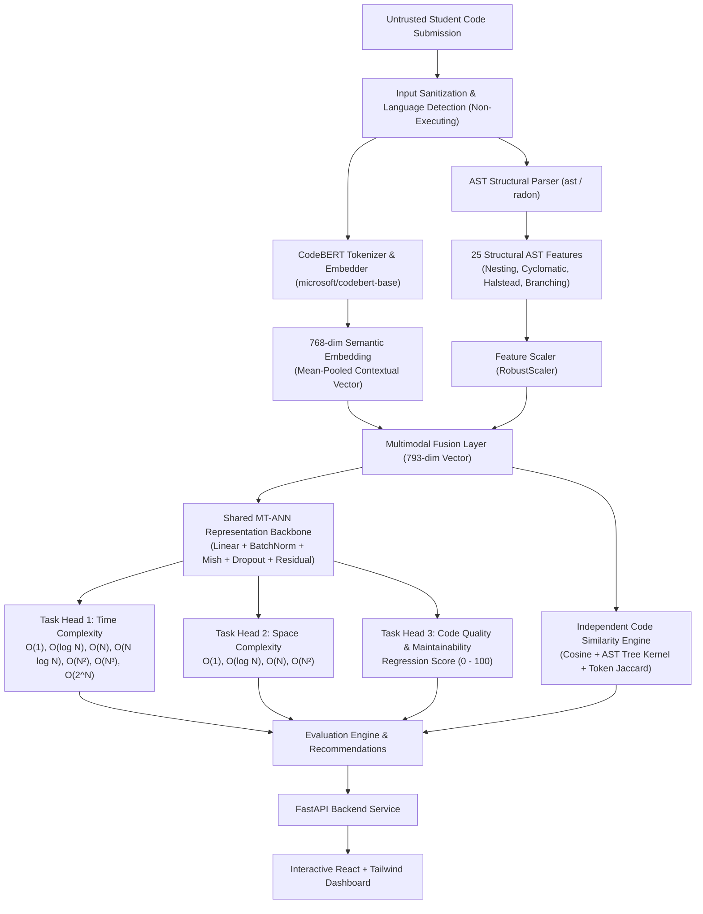

# AI-Based Automated Code Grading and Algorithmic Complexity Prediction Using AST and ANN

A research-oriented, end-to-end AI/ML platform that evaluates source code submissions statically without execution. The system extracts 25 structural Abstract Syntax Tree (AST) metrics and generates 768-dimensional semantic embeddings via CodeBERT (`microsoft/codebert-base`), fusing them into a 793-dimensional multimodal representation for a Multi-Task Artificial Neural Network (MT-ANN).

---

## System Architecture



---

## Research Scope, Technical Risks & Mitigation

| Technical Challenge | Theoretical / Practical Risk | Mitigation Strategy |
| :--- | :--- | :--- |
| **Rice's Theorem & Halting Problem** | Exact runtime complexity is statically undecidable for general Turing machines. | Models predict empirical asymptotic complexity classes from static patterns; results are framed as probabilistic approximations rather than formal proofs. |
| **Untrusted Code Execution** | Remote Code Execution (RCE) vulnerability if student code runs. | Strict zero-execution policy. All AST extraction and tokenization are performed purely via static parse trees (`ast.parse`) with bounded timeouts and size limits. |
| **Ground Truth Labeling (CodeNet)** | CodeNet provides runtime in milliseconds, not explicit Big-O classes. | Algorithmic problem categorization using standard competitive programming taxonomies, verified algorithmic patterns, and Radon Maintainability Index for quality regression. |
| **CodeBERT Sequence Limit (512 tokens)** | Student submissions exceeding 512 tokens are truncated by standard tokenizers. | Sliding-window chunked encoding with mean-pooling aggregation across statements. |
| **GPU VRAM Constraints (6 GB RTX 4050)** | Transformer models can exhaust GPU VRAM during batched inference/training. | Frozen CodeBERT feature extraction, FP16 mixed-precision autocast, batch size 32, and embedding pre-caching to disk. |

---

## Directory Structure

```
project/
├── backend/                  # FastAPI Application
│   ├── api/                  # Route handlers (analyze, compare, history, model-info)
│   ├── database/             # SQLAlchemy ORM models and SQLite/PostgreSQL connectors
│   ├── schemas/              # Pydantic v2 request/response schemas
│   └── services/             # Core business logic orchestration
│
├── frontend/                 # React 18 + Vite + Tailwind CSS Dashboard
│   └── src/                  # Components, Pages, and API services
│
├── src/                      # Core AI/ML Research Engine
│   ├── config.py             # Centralized settings and hyperparameters
│   ├── utils/                # Logging, device management, input sanitization
│   ├── data/                 # CodeNet dataset loaders, filtering, labeling
│   ├── features/             # 25 AST extractors and CodeBERT embedding pipeline
│   ├── models/               # Multi-Task ANN, Baselines (RF/XGBoost), Training & Eval
│   └── similarity/           # Multi-modal code similarity engine
│
├── datasets/                 # Raw, processed, and cached embeddings
├── saved_models/             # Trained PyTorch weights and baseline model artifacts
├── reports/                  # Confusion matrices, training curves, research metrics
├── tests/                    # Comprehensive Pytest suite
├── .env.example              # Environment variable template
├── requirements.txt          # Python dependencies
└── README.md                 # Project documentation
```

---

## Hardware Target Profile

- **Processor**: Intel Core i7-13700HX (16 Cores, 24 Threads)
- **GPU**: NVIDIA GeForce RTX 4050 Laptop GPU (6 GB GDDR6 VRAM, Compute Capability 8.9)
- **Acceleration**: CUDA 12.1 + cuDNN + FP16 Mixed Precision

---

## Phase 1 Verification

To verify the foundational setup and run the Phase 1 test suite:

```powershell
# Activate virtual environment
.\venv\Scripts\Activate.ps1

# Run Phase 1 verification tests
python -m pytest tests/test_environment.py -v
```

All 7 core test assertions cover Python version compatibility, directory trees, CUDA hardware profiling, 25 AST feature configuration, deterministic seeding, and non-executing input sanitization.
